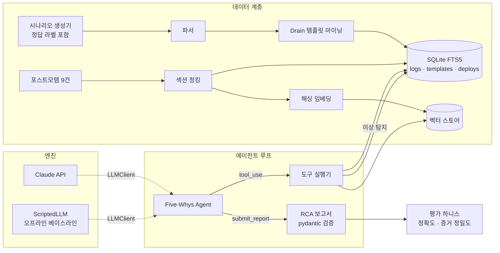

# Five Whys · 주문 서비스 장애 조사

운영자가 사건을 의뢰하면 FastAPI가 작업 ID를 발급한다. 워커는 요청한 팀이 볼 수 있는 관측 로그, 변경 이력, 과거 장애 보고서를 조사한다. 면접관은 브라우저에서 원인 후보를 선택해 **어떤 로그와 배포, 어느 문서의 몇 번째 줄이 그 판단을 뒷받침했는지** 확인할 수 있다.

[공개 데모](https://sokldjs554.github.io/five-whys-agent/) · [실제 Claude 조사](https://sokldjs554.github.io/five-whys-agent/claude.html) · [백엔드 구현](src/fivewhys/investigation/) · [통합 테스트 결과](docs/verification/RESULTS.md)

플랫폼팀 실제 조사에서 Claude는 배포와 로그 5건을 인용했습니다. 같은 작업을 재전송해도 분석은 1회, 호출은 2회였습니다. [최종 판단·원문·콜백 기록](docs/verification/claude/runs/e09c4226-20bf-462f-a673-c5dab75a9f7d/README.md) 공개 데모에 저장된 주문팀·플랫폼팀 기록은 규칙 엔진으로 생성했습니다. [실행 절차](docs/verification/claude/README.md) · [원문 대조 기준](docs/verification/order-evidence-rubric.md) · [두 사건의 검색 평가](docs/verification/TWO_CASE_RETRIEVAL.md)

## 실행과 3분 시연

Docker와 Compose v2.23.1 이상이 필요하다. 체크아웃의 루트에서 실행한다. 처음 시작할 때 서비스 이미지를 내려받고 합성 자료를 색인한다.

```bash
FIVEWHYS_REVISION=$(git rev-parse HEAD) docker compose up -d --build --wait
```

브라우저에서 **http://127.0.0.1:8750/** 을 연다. 시연 데이터는 `db_pool_exhaustion`, 시드 42다. 기본 규칙 엔진은 키 없이 **지금 생성한 작업**을 처리하며 매번 Milvus와 Neo4j를 조회한다. `Claude`를 선택하면 같은 도구 루프가 Anthropic Messages API를 호출한다. `ANTHROPIC_API_KEY`와 `FIVEWHYS_MODEL`을 워커/API 환경에 제공한 뒤 Compose를 다시 실행하면 된다.

1. **주문팀에서 조사 실행.** 2026년 7월 3일 14:00 KST 주문 서비스 지연 사건과 미리 입력된 질문을 확인한다. 요청 후 작업 세부 정보에서 실제 ID와 접수·처리·완료 시간을 확인한다.
2. **가설과 근거 열기.** 주문 조회 쿼리 변경 후보를 선택한다. 로그의 HikariPool 대기, `order-service v2.4.0` 변경 내용, 과거 보고서의 인용 행을 차례로 연다. 타임라인에서는 배포 시각과 첫 오류 시각을 비교한다.
3. **검색 비교.** 같은 질문에 대한 벡터 후보와 그래프 검증 후 후보를 확인한다. 증상이 비슷한 다른 장애 보고서의 서비스와 현재 배포가 실제 변경한 서비스를 비교한다. 원문과 관계 경로는 각각 열어 볼 수 있다.
4. **콜백과 권한.** 결과 전달의 첫 503 이후 콜백 재전송을 누른다. HTTP 200 응답까지의 전송 이력, 작업 ID와 LLM 호출 수를 확인한다. 플랫폼팀 계정으로 바꿔 같은 질문을 다시 실행하면 DB 슬로우 쿼리 원문에 접근할 수 있다. 주문팀의 이전 작업은 해당 팀 전용이다.

기존 CLI `fivewhys demo --scenario db_pool_exhaustion`, `fivewhys evaluate`, 동기 `POST /analyze`와 `GET /reports/{report_id}`도 사용할 수 있다. [변경 전 CLI 캡처와 실행 결과](docs/verification/baseline/README.md) · [REST 및 콜백 연동 예시](docs/INTEGRATION.md)

## 지원서에 연결할 구현 근거

| 업무·기술 | 코드 | 검증 | 면접에서 볼 장면 |
|---|---|---|---|
| Python · FastAPI · REST | [작업·결과·근거 라우트](src/fivewhys/investigation/routes.py), [기존 동기 API](src/fivewhys/api.py) | [인증·입력·상태 계약](tests/test_investigation_api.py), [기존 API 회귀](tests/test_api.py) | 조사 실행, 작업 ID로 상태 조회, 원문 열기 |
| 직접 LLM 호출 · 프롬프트 · Pydantic | [Anthropic 어댑터](src/fivewhys/agent/llm.py), [공유 도구 루프](src/fivewhys/agent/five_whys.py), [조사 프롬프트·보고서 검증](src/fivewhys/investigation/analysis.py) | [SDK 요청 본문·인용·수정 한도·호출 실패](tests/test_investigation_analysis.py) | 엔진 선택, 원인 후보별 인용과 도구 실행 기록 |
| LangChain · Milvus · 인덱싱 | [원문 청크·버전·권한](src/fivewhys/investigation/retrieval_corpus.py), [Document·Retriever·임베딩 저장](src/fivewhys/investigation/retrieval.py) | [검색·색인 테스트](tests/test_investigation_retrieval.py), [인덱싱 작업 HTTP 흐름](tests/test_investigation_flow.py) | 벡터 후보, 원문 위치와 버전 |
| Neo4j · Vector + Graph RAG | [Cypher 경로 검증·확장](src/fivewhys/investigation/retrieval.py) | [동일 질문·정답표](src/fivewhys/evaluation/retrieval_gold.json), [비교 평가](src/fivewhys/evaluation/retrieval_benchmark.py) | 검색 비교, 배포 → 변경 서비스, 서비스 간 의존 경로 |
| 권한 경계 | [팀 세션·작업 소유권](src/fivewhys/investigation/routes.py), [벡터·그래프 필터](src/fivewhys/investigation/retrieval.py), [모델 입력·출력 검증](src/fivewhys/investigation/analysis.py) | [두 팀의 후보·모델 입력·원문 검증](tests/test_investigation_flow.py) | 주문팀에서 플랫폼팀으로 전환 후 동일 사건 재조사 |
| RabbitMQ · PostgreSQL · 콜백 | [작업·전송 예약의 원자적 저장](src/fivewhys/investigation/jobs.py), [컨슈머와 복구](src/fivewhys/investigation/worker.py), [테스트 수신기](src/fivewhys/investigation/receiver.py) | [중복·재시작·수신 후 중단](tests/test_jobs_integration.py), [HTTP 재전송 검증](tests/test_investigation_flow.py) | 전송 이력에서 503 → 200, 작업 ID·호출 수 비교 |
| Docker · pytest · Git · 연동 문서 | [Compose](docker-compose.yml), [CI](.github/workflows/test.yml), [OpenAPI](docs/openapi.json), [수신기 명세](docs/callback-openapi.json) | [브라우저 시연 검사](tests/browser/smoke.py), [기준 실행](docs/verification/baseline/README.md) | 데스크톱·모바일 전체 시연 및 Swagger UI |

화면은 사건 요약·행동을 상단에 두고, 관측 이벤트를 시간순으로 열람하는 방식을 채택했다. 각 판단에서 원문과 관계로 이동할 수 있게 연결했다. [Datadog 사건 상세](https://docs.datadoghq.com/incident_response/incident_management/investigate/) · [Datadog 사건 타임라인](https://docs.datadoghq.com/incident_response/incident_management/investigate/timeline/) · [PagerDuty 사건 상태](https://docs.pagerduty.com/incident-management/incidents/overview)

## 재현

```bash
# Compose의 실제 데이터베이스·브로커·수신기와 pytest 전체 실행
docker compose run --build --rm test

# 시드와 정답표 고정, 같은 질문으로 검색 품질·지연 비교
docker compose exec -T api python -m fivewhys.evaluation.retrieval_benchmark

# 호스트 Chromium으로 두 화면 크기의 실제 조작·캡처
python -m pip install playwright
python tests/browser/smoke.py --url http://127.0.0.1:8750 --output ./captures
```

[측정 조건과 결과](docs/verification/RESULTS.md)

---

## 기존 Five Whys 에이전트

**LLM 에이전트 기반 장애 로그 근본원인분석(RCA) 자동화**

장애가 나면 SRE는 로그를 뒤지고, 배포 이력을 대조하고, "왜?"를 반복하며 근본 원인을
추적합니다. 이 프로젝트는 그 과정 — 도요타의 **5 Whys 기법** — 을 LLM 에이전트의
루프 설계로 옮긴 시스템입니다. 에이전트는 매 단계 도구를 호출해 **로그 증거를 수집**하고,
증거 없는 결론을 내릴 수 없도록 강제됩니다.

```
장애 발생 → [에러 타임라인] → [이상 템플릿 탐지] → [로그 검색/문맥] → [변경 이력 대조]
         → [과거 유사 장애 RAG] → 5 Whys 보고서 (모든 단계에 로그 id 인용)
```

## 왜 이 프로젝트인가

문서 요약 챗봇류 프로젝트와 달리, 이 프로젝트는 **"LLM의 결론을 어떻게 신뢰할 것인가"**
라는 문제를 정면으로 다룹니다.

1. **증거 강제**: 보고서의 모든 "왜?" 단계는 실제 로그 id를 인용해야 하며,
   평가 하니스가 인용된 id의 실존/시간창 포함 여부를 검증합니다 (환각 인용 탐지).
2. **정량 평가**: 정답을 아는 합성 장애 시나리오 5종(시드 가변)으로
   근본원인 서비스 정확도, 원인 변경 식별율, 증거 정밀도를 자동 채점합니다.
3. **베이스라인 비교**: LLM 없이 동작하는 휴리스틱 엔진(ScriptedLLM)이 같은
   에이전트 루프를 돌기 때문에, "LLM이 휴리스틱 대비 무엇을 더 잘하는가"를
   같은 잣대로 비교할 수 있습니다.

## 핵심 구성 요소

| 구성 요소 | 구현 내용 |
|---|---|
| 로그 템플릿 마이닝 | **Drain 알고리즘 직접 구현** (파라미터 마스킹 + 고정 깊이 prefix tree + 토큰 유사도 병합) |
| 이상 탐지 | 베이스라인 대비 장애 구간 템플릿 발생률 비교 (레벨 가중 log-ratio 스코어) |
| 로그 검색 | SQLite **FTS5 BM25** (운영 규모용 **Elasticsearch 어댑터** 포함, 동일 인터페이스) |
| RAG | 과거 장애보고서 9건 → 섹션 인지 청킹 → 임베딩 → **하이브리드 검색(BM25+벡터+RRF)** |
| 에이전트 | Claude Messages API **수동 tool-use 루프** (7개 도구, 보고서 스키마 pydantic 검증 + 자가 수정) |
| MCP 서버 | 로그 분석 도구를 **MCP 표준**으로 노출 → Claude Desktop/Code에서 바로 사용 |
| 평가 | 규칙 기반 자동 채점 + 선택적 LLM-as-judge (구조화 출력) |
| API/CLI | FastAPI REST API + CLI (`demo` / `evaluate` / `serve` / `mcp-serve`) |

## 아키텍처



## 빠른 시작

```bash
git clone https://github.com/sokldjs554/five-whys-agent.git && cd five-whys-agent
python -m venv .venv && source .venv/bin/activate
pip install -e ".[dev,mcp]"

# 1) API 키 없이 바로 실행되는 오프라인 데모 (휴리스틱 베이스라인)
fivewhys demo --scenario db_pool_exhaustion

# 2) Claude 에이전트로 실행
export ANTHROPIC_API_KEY=sk-ant-...
fivewhys demo --scenario cache_stampede --engine claude

# 3) 전 시나리오 정량 평가
fivewhys evaluate --engine scripted --runs 3

# 4) REST API
fivewhys serve   # POST /analyze, GET /scenarios, GET /reports/{id}

# 5) MCP 서버 (Claude Desktop/Code 연동)
fivewhys mcp-serve --scenario db_pool_exhaustion

# 테스트
pytest
```

### 선택 실습

```bash
# MCP 서버 — 호스트 앱 없이 MCP 인터페이스(list_tools/call_tool)를 직접 호출
python examples/mcp_client_demo.py

# Elasticsearch 백엔드 — 같은 질의를 SQLite/ES 두 저장소에 던져 비교
docker compose up -d elasticsearch && pip install -e ".[es]"
python examples/es_backend_demo.py

# LLM-as-judge — 규칙 채점 + 인과 사슬 일관성 LLM 판정 (API 키 필요)
python examples/judge_demo.py
```

## 데모 출력 (오프라인, API 키 불필요)

```
[5 Whys 인과 사슬]
  Why 1. 왜 사용자 요청에 문제가 생겼는가?
     → api-gateway에서 'Upstream timeout: order-service GET <*> ...' 패턴이
       급증했다 (장애 구간 48건, 베이스라인 0건).   증거 로그: [1913, 1916, 1925]
  Why 2. 왜 api-gateway의 처리에 문제가 생겼는가?
     → order-service에서 'HikariPool-1 - Connection is not available ...' 패턴이
       급증했다 (장애 구간 58건, 베이스라인 0건).   증거 로그: [1819, 1821, 1823]
  Why 3. 왜 order-service에서 이 문제가 시작됐는가?
     → 장애 직전 변경: order-service v2.4.0 배포 — 주문 조회 쿼리 리팩터링

[근본 원인] (order-service) ... 트리거는 'v2.4.0 배포'로 판단
[유사 과거 장애] 2025-11-14-db-connection-pool
```

## 평가 결과

**베이스라인** — 시나리오 5종 × 시드 3개 = 15회 (`fivewhys evaluate --runs 3`):

| 엔진 | 근본원인 서비스 정확도 | 키워드 정확도 | 원인 변경 식별 | 평균 증거 정밀도 |
|---|---|---|---|---|
| scripted (휴리스틱) | 100% (15/15) | 100% | 100% | 1.00 |

**LLM 엔진 대비** — 동일 시나리오를 Claude 에이전트로 실행한 결과:

| 지표 | scripted | Claude (claude-opus-5) |
|---|---|---|
| 근본원인 서비스 / 원인 변경 식별 | 정확 | 정확 |
| 증거 정밀도 (환각 인용 없음) | 1.00 | **1.00** |
| 인용한 로그 수 | 6~12건 | **24~30건** |
| 왜? 체인 깊이 | 3~5단계 | **5~6단계** |
| 재발 방지 대책 수 | 3건 (규칙 기반 템플릿) | **7건 (맥락 기반)** |

**정확도는 같지만 분석의 깊이가 다릅니다.** 두 엔진 모두 근본 원인 서비스와 원인 배포를
맞히지만, LLM 에이전트는 인과 사슬을 조직적 원인까지 밀고 내려갑니다:

> *"…근본적으로는 배포 전 EXPLAIN 검토·슬로우쿼리 회귀 게이트가 CI에 없어 인덱스
> 미보유 쿼리가 걸러지지 않았고, 2025-11-14 동일 장애의 대책(인덱스 추가·CI 게이트)이
> 실질적으로 유지·완료되지 않아 그대로 재발했다."*
>
> — Claude 엔진, `db_pool_exhaustion` (Why 5)

과거 포스트모템(RAG로 검색한 문서)에 "[완료] 인덱스 추가"로 기록돼 있는데도 같은 장애가
재발했다는 **모순을 스스로 발견**하고, 스키마 드리프트 검사와 액션 아이템 이행 감사를
대책으로 제안했습니다. 이는 설계에 넣은 규칙이 아니라 증거 수집 과정에서 도출된 것으로,
휴리스틱 베이스라인이 원리적으로 도달할 수 없는 지점입니다.

측정 항목:
- **근본원인 서비스 정확도** — 인과 사슬의 출발 서비스를 맞췄는가 (에러가 가장 많은 서비스 ≠ 근본 원인)
- **원인 변경 식별** — 장애를 유발한 배포/설정 변경을 특정했는가
- **증거 정밀도** — 인용한 로그 id가 실존하며 장애 구간에 속하는 비율 (환각 인용 탐지)

> 합성 시나리오의 난이도상 베이스라인도 정확도 만점을 받습니다. 정확도 격차를 만들려면
> 휴리스틱이 원리적으로 실패하는 시나리오가 필요하며, 그 설계는
> [docs/EVALUATION.md](docs/EVALUATION.md)의 로드맵에 정리했습니다.

## 기술적 의사결정

| 결정 | 이유 |
|---|---|
| Drain을 라이브러리 대신 직접 구현 | 대용량 로그 → 템플릿 압축이 이 도메인의 핵심이라 내부 동작을 이해하고 통제해야 했음. 테스트에 알고리즘의 알려진 한계(선행 토큰 파라미터 분화)도 명시 |
| SQLite FTS5 기본 + ES 어댑터 | 로컬에서 외부 의존성 0으로 전체 파이프라인 실행 가능. 검색 인터페이스를 추상화해 운영 환경에서는 Elasticsearch로 교체 (`store/es.py` + docker-compose) |
| RRF 하이브리드 검색 | BM25(정확 용어)와 벡터(의미 유사) 랭킹을 점수 보정 없이 순위로 융합 — Elasticsearch hybrid search와 동일 방식 |
| 수동 tool-use 루프 | SDK 헬퍼 대신 루프를 직접 구현해 (1) LLMClient 추상화로 오프라인 엔진 교체 가능 (2) 보고서 제출을 가로채 pydantic 검증 → 실패 시 오류를 돌려줘 모델이 자가 수정 |
| ScriptedLLM 베이스라인 | "에이전트 루프"와 "LLM 품질"을 분리해 테스트. CI에서 API 비용 0으로 전체 통합 테스트, 평가에서는 LLM 대비 기준선 역할 |
| 임베딩 추상화 (기본: 해싱 벡터라이저) | 외부 모델 의존 없이 결정적으로 동작 → 재현 가능한 테스트. `Embedder` 프로토콜만 만족하면 sentence-transformers 등으로 교체 가능 |
| 합성 시나리오 + 정답 라벨 | LLM 출력의 "그럴듯함"이 아니라 검증 가능한 정확도로 평가. 실로그는 정답이 없어 정량 평가 불가 |

## 프로젝트 구조

```
src/fivewhys/
├── logs/          # parser, drain(템플릿 마이닝), anomaly(이상 탐지)
├── store/         # SQLite FTS5 저장소, Elasticsearch 어댑터
├── rag/           # chunker, embedder, vectorstore, retriever(RRF)
├── scenarios/     # 정답 라벨 포함 합성 장애 시나리오 5종
├── agent/         # LLM 추상화, 도구 정의/실행기, Five-Whys 루프, 오프라인 엔진
├── evaluation/    # 규칙 기반 채점 하니스, LLM-as-judge
├── mcp_server/    # MCP 표준 서버 (Claude Desktop/Code 연동)
├── data/postmortems/  # 과거 장애 보고서 코퍼스 9건 (RAG 지식베이스)
├── api.py         # FastAPI REST API
└── cli.py         # CLI 진입점
tests/             # 69개 테스트 (전부 오프라인, API 키 불필요)
```

## 한계와 로드맵

- **합성 데이터의 한계**: 시나리오가 "변경 → 장애" 패턴에 치우쳐 있어 베이스라인도
  만점이 나온다. 실제 가치 검증을 위해 휴리스틱이 실패하는 시나리오
  (다중 복합 원인, 로그에 없는 원인, 오해를 유발하는 무관 배포)를 추가할 계획
- **스트리밍 적재**: 현재는 배치 적재. Drain은 온라인 알고리즘이므로 Kafka 등
  스트림 소스 연결이 자연스러운 다음 단계
- **임베딩 업그레이드**: 해싱 벡터라이저 → 다국어 임베딩 모델 교체 후 검색 품질 A/B
- **LLM-judge 상시화**: 현재는 선택 실행. 체인 일관성 채점을 평가 기본 항목으로 편입

## 라이선스

MIT
